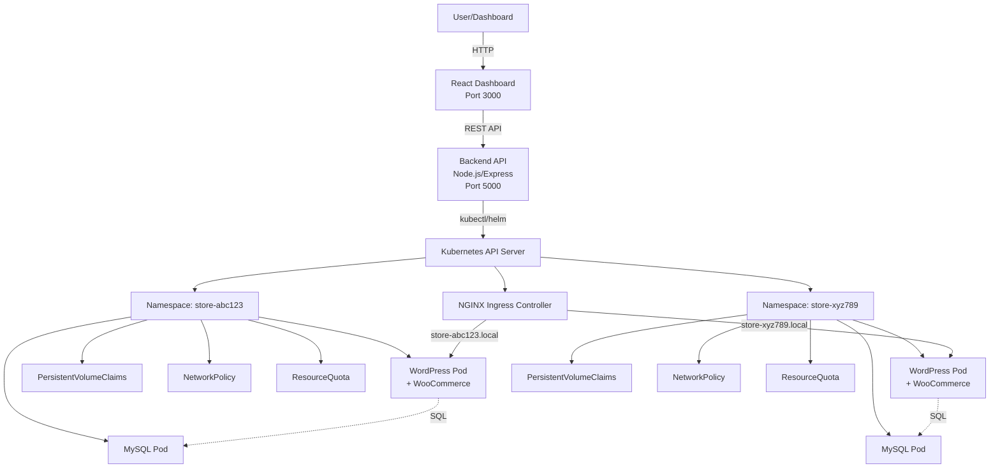
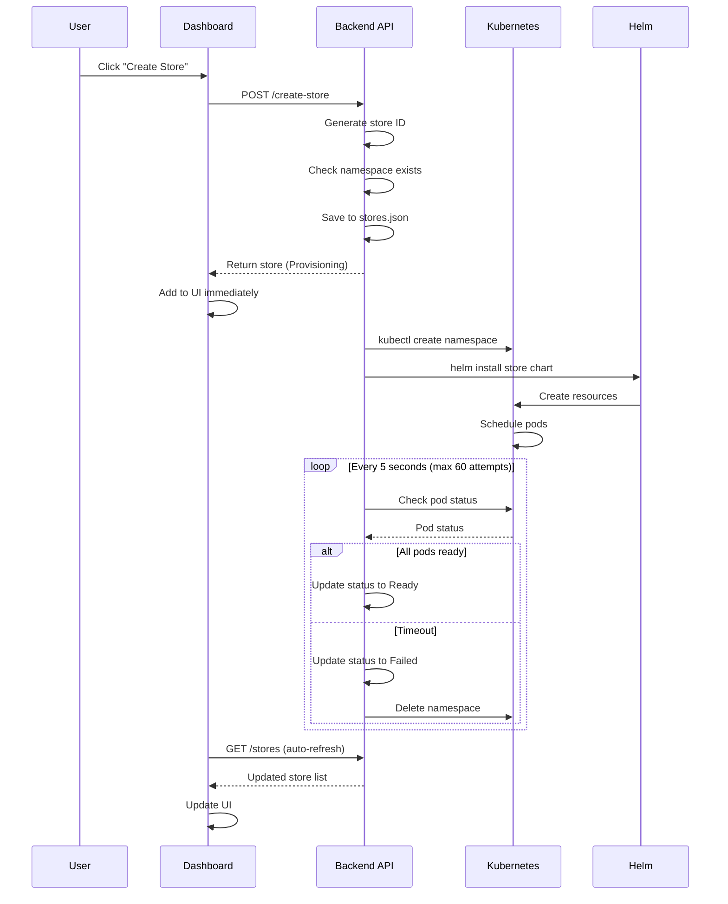
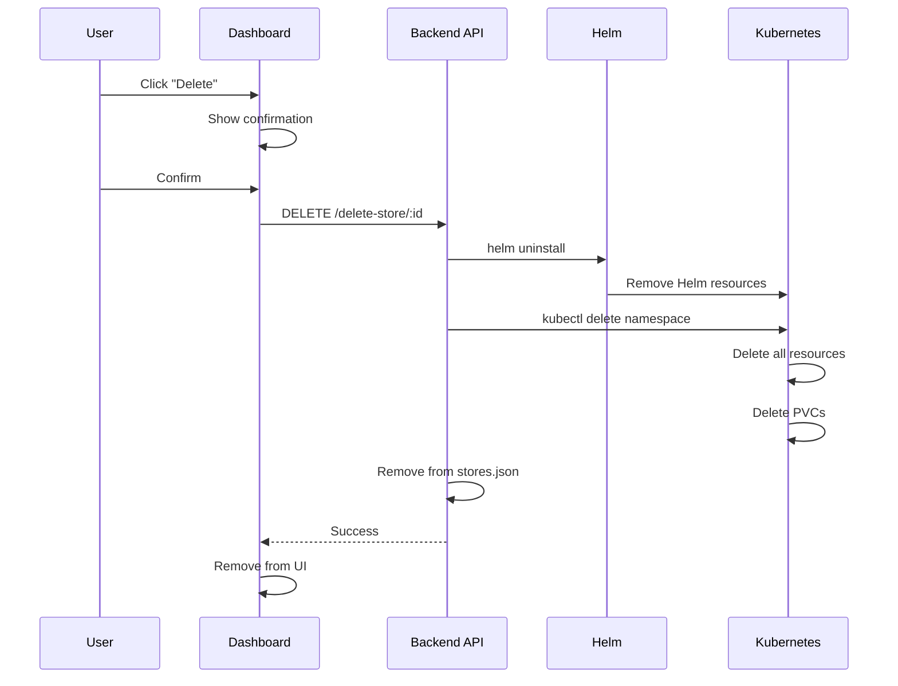

# Kubernetes Store Orchestration - System Design & Architecture

## Overview

The Kubernetes Store Orchestration Platform is a multi-tenant system that enables dynamic provisioning of isolated WooCommerce stores on Kubernetes. Each store runs in its own namespace with dedicated resources, providing strong isolation and independent lifecycle management.

## Architecture Diagram



## Component Responsibilities

### 1. React Dashboard (`dashboard/`)
**Purpose**: User interface for store management

**Responsibilities**:
- Display list of all provisioned stores
- Show real-time store status (Provisioning/Ready/Failed)
- Trigger store creation via API
- Delete stores with confirmation
- Auto-refresh status every 5 seconds
- Display store URLs and metadata

**Technology**: React 18, Axios, CSS

### 2. Backend API (`backend/server.js`)
**Purpose**: Orchestration layer between UI and Kubernetes

**Responsibilities**:
- Accept store creation requests
- Generate unique store IDs
- Execute kubectl/Helm commands
- Monitor pod readiness status
- Maintain store state in JSON file
- Handle cleanup on failures
- Provide health check endpoint

**Key Features**:
- **Idempotency**: Checks if namespace exists before creation
- **Async Provisioning**: Returns immediately, provisions in background
- **Status Polling**: Monitors pod readiness with 60 attempts (5 min timeout)
- **Cleanup on Failure**: Automatically removes failed resources
- **Error Handling**: Comprehensive try-catch with logging

**API Endpoints**:
- `POST /create-store` - Create new store
- `GET /stores` - List all stores
- `GET /stores/:id/status` - Get store status
- `DELETE /delete-store/:id` - Delete store
- `GET /health` - Health check

### 3. Helm Chart (`helm/store/`)
**Purpose**: Kubernetes resource templates for store deployment

**Templates**:
- `wordpress.yaml` - WordPress deployment, service, PVC
- `mysql.yaml` - MySQL deployment, service, PVC, secret
- `ingress.yaml` - Ingress rule for external access
- `networkpolicy.yaml` - Network isolation rules
- `resourcequota.yaml` - Namespace resource limits
- `limitrange.yaml` - Default container limits
- `serviceaccount.yaml` - Pod identity

**Configuration** (`values.yaml`):
- Resource requests/limits (CPU, memory)
- Liveness/readiness probes
- Security contexts
- Storage configuration
- Network policies
- Quota limits

## Data Flow

### Store Creation Flow



### Store Deletion Flow



## Design Decisions & Tradeoffs

### 1. Namespace-Per-Store Isolation

**Decision**: Each store gets its own Kubernetes namespace

**Rationale**:
- Strong resource isolation
- Easy cleanup (delete namespace = delete everything)
- Clear ownership boundaries
- Namespace-level quotas and policies

**Tradeoff**: Higher resource overhead vs shared namespace approach

### 2. Helm for Deployment

**Decision**: Use Helm charts instead of raw manifests

**Rationale**:
- Templating for dynamic values (store ID, passwords)
- Version management and rollback capability
- Easier local-to-production transition (values files)
- Industry standard for Kubernetes deployments

**Tradeoff**: Additional dependency vs simpler kubectl apply

### 3. Async Store Provisioning

**Decision**: Return immediately, provision in background

**Rationale**:
- Better UX (no long-running HTTP requests)
- Supports concurrent store creation
- Dashboard can poll for status updates
- Prevents timeout issues

**Tradeoff**: More complex state management vs synchronous approach

### 4. JSON File for State

**Decision**: Store metadata in `stores.json` file

**Rationale**:
- Simple, no database required
- Easy to inspect and debug
- Sufficient for prototype/demo
- Atomic writes with fs-extra

**Tradeoff**: Not suitable for production scale (use database/etcd)

### 5. NetworkPolicy for Isolation

**Decision**: Implement deny-by-default network policies

**Rationale**:
- Prevents cross-store communication
- Limits blast radius of compromised store
- Explicit allow rules for required traffic
- Security best practice

**Tradeoff**: More complex networking vs no isolation

## Scaling Strategy

### Horizontal Scaling

**Backend API**:
- Stateless design (state in file, can use shared volume)
- Can run multiple replicas behind load balancer
- Each replica can handle store operations independently

**Dashboard**:
- Static React app, easily scalable
- Can be served from CDN
- No server-side state

**Stores**:
- Each store is independent
- No shared resources between stores
- Can provision hundreds of stores (limited by cluster capacity)

### Vertical Scaling

**Resource Limits**:
- WordPress: 256Mi-512Mi RAM, 100m-500m CPU
- MySQL: 256Mi-512Mi RAM, 100m-500m CPU
- Can adjust per-store based on traffic

**Storage**:
- Default 2Gi per PVC (WordPress + MySQL)
- Can increase for high-traffic stores
- Use storage classes for different tiers

### Provisioning Throughput

**Current**: Sequential provisioning with 5-minute timeout

**Improvements**:
- Queue-based system for concurrent provisioning
- Worker pool to handle multiple stores in parallel
- Kubernetes operators for declarative management
- Pre-warmed namespaces for faster provisioning

## Failure Handling

### Idempotency

**Namespace Check**: Before creating, verify namespace doesn't exist
- Prevents duplicate resources
- Returns 409 Conflict if exists
- Safe to retry failed requests

### Cleanup on Failure

**Automatic Cleanup**:
1. If Helm install fails → uninstall release
2. If pod readiness times out → delete namespace
3. Update store status to "Failed" with error message
4. Remove orphaned resources

### Recovery Mechanisms

**Pod Failures**:
- Liveness probes restart unhealthy containers
- Readiness probes prevent traffic to unready pods
- Deployment ensures desired replica count

**PVC Binding Issues**:
- Pods wait for PVC to bind
- Timeout after 5 minutes
- Clear error message in store status

**Network Issues**:
- NetworkPolicy allows required traffic
- Explicit deny-all with allow rules
- DNS resolution for service discovery

## Security Considerations

### 1. Secrets Management

**Current**: Kubernetes Secrets with stringData
- Passwords in Helm values (not ideal)
- Secrets created per-namespace
- Not exposed in logs or API responses

**Production Improvements**:
- External Secrets Operator
- HashiCorp Vault integration
- Sealed Secrets for GitOps

### 2. Network Isolation

**NetworkPolicy**:
- Deny all ingress/egress by default
- Allow ingress from ingress controller to WordPress
- Allow WordPress to MySQL within namespace
- Allow DNS resolution
- Allow outbound HTTP/HTTPS for updates

### 3. Resource Limits

**ResourceQuota** (per namespace):
- CPU: 1 core request, 2 core limit
- Memory: 1Gi request, 2Gi limit
- Max 3 PVCs

**LimitRange** (per container):
- Default: 100m CPU, 256Mi RAM
- Max: 1 core CPU, 1Gi RAM
- Prevents resource exhaustion

### 4. Container Security

**Security Contexts**:
- fsGroup for file permissions
- Non-root where possible (MySQL, WordPress need specific users)
- Read-only root filesystem (future improvement)

### 5. RBAC

**Future**: ServiceAccount with minimal permissions
- Create/delete namespaces
- Helm operations
- Read pod status
- No cluster-admin access

## Local vs Production Differences

### Local Development (Docker Desktop/Kind)

**Configuration**:
- `.local` domains with `/etc/hosts` entries
- hostPath or local storage class
- No TLS
- Lower resource limits
- Single-node cluster

**Setup**:
```bash
# Enable Kubernetes in Docker Desktop
# Install NGINX Ingress
kubectl apply -f https://...ingress-nginx.../deploy.yaml
```

### Production (k3s on VPS)

**Configuration** (`values-prod.yaml`):
- Real domain names (e.g., `store-abc123.example.com`)
- DNS A records pointing to VPS IP
- TLS with cert-manager + Let's Encrypt
- Production storage class (local-path for k3s)
- Higher resource limits
- Multi-node cluster (optional)

**Setup**:
```bash
# Install k3s
curl -sfL https://get.k3s.io | sh -

# Install cert-manager
kubectl apply -f https://github.com/cert-manager/cert-manager/releases/download/v1.13.0/cert-manager.yaml

# Configure DNS
# Point *.example.com to VPS IP

# Deploy with production values
helm install store-abc123 ./helm/store -f values-prod.yaml
```

**Changes Required**:
1. Update `ingress.host` in values
2. Enable TLS with cert-manager annotations
3. Configure storage class
4. Set production resource limits
5. Configure external database (optional)
6. Set up monitoring/logging

## Upgrade & Rollback Strategy

### Helm-Based Upgrades

**Upgrade Store**:
```bash
# Update chart or values
helm upgrade store-abc123 ./helm/store -n store-abc123

# Check status
helm status store-abc123 -n store-abc123
```

**Rollback**:
```bash
# List revisions
helm history store-abc123 -n store-abc123

# Rollback to previous
helm rollback store-abc123 -n store-abc123

# Rollback to specific revision
helm rollback store-abc123 2 -n store-abc123
```

### Zero-Downtime Updates

**Strategy**:
1. Update Helm chart with new image/config
2. Helm performs rolling update
3. New pods created before old ones terminated
4. Readiness probes ensure traffic only to ready pods
5. PVCs persist data across updates

## Monitoring & Observability

### Current State

**Logging**:
- Backend API logs to console
- Structured logging with prefixes ([CREATE], [DELETE], etc.)
- Pod logs accessible via `kubectl logs`

**Metrics**:
- Store count in `stores.json`
- Pod status via Kubernetes API
- Resource usage via `kubectl top`

### Production Improvements

**Metrics Collection**:
- Prometheus for metrics scraping
- Grafana for visualization
- Custom metrics: stores created, provisioning time, failure rate

**Logging**:
- Centralized logging (ELK/Loki)
- Structured JSON logs
- Log aggregation across all stores

**Tracing**:
- OpenTelemetry for distributed tracing
- Track provisioning flow end-to-end
- Identify bottlenecks

**Alerting**:
- Alert on provisioning failures
- Alert on resource quota exceeded
- Alert on pod crash loops

## Cost Analysis

### Local Development

**Cost**: $0 (uses local machine)

**Requirements**:
- 4GB RAM minimum
- 2 CPU cores
- 20GB disk space

### Production (VPS)

**Example**: DigitalOcean Droplet

**Small Setup** ($12/month):
- 2GB RAM, 1 vCPU
- Can run 2-3 stores comfortably
- Suitable for demo/testing

**Medium Setup** ($24/month):
- 4GB RAM, 2 vCPU
- Can run 5-10 stores
- Suitable for small production

**Large Setup** ($48/month):
- 8GB RAM, 4 vCPU
- Can run 15-20 stores
- Suitable for production use

**Additional Costs**:
- Domain name: $10-15/year
- TLS certificates: Free (Let's Encrypt)
- Backups: $1-2/month per store

## Future Enhancements

### Short Term
1. Add WooCommerce auto-installation via init container
2. Implement rate limiting on API
3. Add per-user store quotas
4. Create RBAC for backend API

### Medium Term
1. Database backup automation
2. Store cloning functionality
3. Custom domain support
4. Metrics dashboard
5. Audit logging

### Long Term
1. Multi-region support
2. Auto-scaling based on traffic
3. Store migration between clusters
4. Kubernetes Operator for declarative management
5. Integration with CI/CD pipelines
